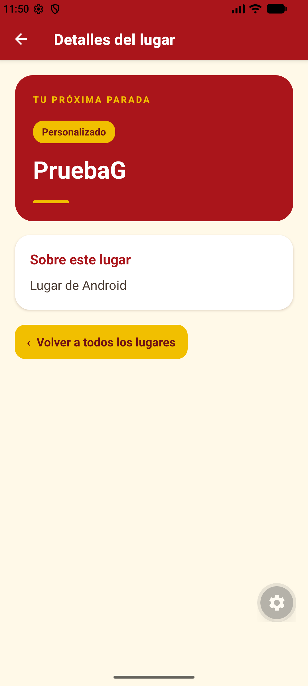
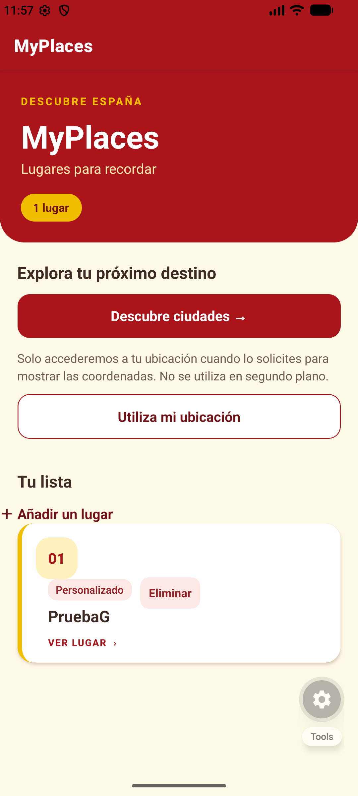
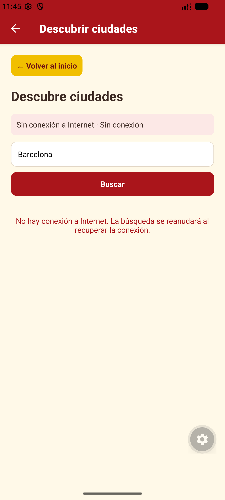
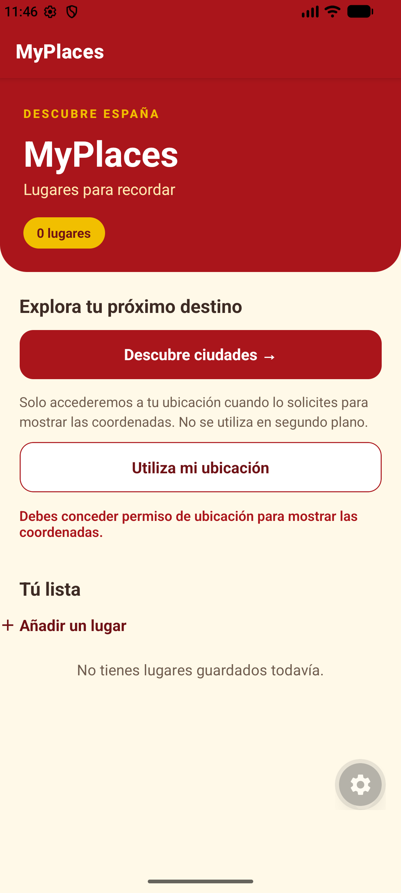

# MyPlaces

Aplicación móvil hecha con React Native, Expo y JavaScript para guardar y
consultar lugares de interés.

## Apartado A: navegación y componentes

El apartado A pide una pantalla principal con una lista de lugares, una pantalla
de detalle, navegación entre ambas, un identificador para cada lugar y al menos
un componente reutilizable. MyPlaces lo resuelve así:

- **Lista principal:** `src/app/index.jsx` carga los lugares guardados con
  `getLocationList()` y los muestra con `FlatList`. Cada elemento usa su `id`
  como clave.
- **Identificador:** cada lugar guardado tiene un `id` único. Ese mismo
  identificador se envía al abrir el detalle.
- **Componente reutilizable:** `src/components/location-cards.jsx` recibe un
  lugar y dibuja su tarjeta. La pantalla principal reutiliza el componente para
  cada elemento de la lista.
- **Navegación:** al pulsar una tarjeta, Expo Router abre
  `/detall/location?id=<id>`. La configuración de pantallas está en
  `src/app/_layout.jsx`.
- **Detalle:** `src/app/detall/location-detail.jsx` lee el parámetro `id`,
  busca el lugar en la lista guardada y muestra su nombre, categoría y
  descripción. Si el identificador no existe, informa del problema y permite
  volver a la lista.

### Recorrido de los datos

almacenamiento local → `index.jsx` → tarjeta reutilizable → ruta de detalle con
el `id` → consulta del lugar guardado → pantalla de detalle.

## Apartado B: formulario y validación

El apartado B pide una pantalla para añadir un lugar con nombre y descripción,
impedir que se guarde con el nombre vacío, informar del error y permitir volver
a la lista. MyPlaces lo resuelve así:

- **Acceso al formulario:** el botón «Añadir un lugar» de
  `src/app/index.jsx` abre la ruta interna `/afegir`.
- **Campos del formulario:** `src/app/afegir.jsx` tiene un `TextInput` para el
  nombre y otro para la descripción. Sus valores se controlan con estado de
  React y `onChangeText`.
- **Validación:** antes de guardar se aplica `trim()` al nombre. Si queda
  vacío, se muestra un mensaje de error. Al escribir de nuevo, el mensaje
  desaparece.
- **Visualización del error:** en `afegir.jsx`, la expresión condicional
  `{error ? (...) : null}` muestra el componente de texto solo cuando `error`
  contiene un mensaje; si está vacío, no se renderiza nada. El atributo
  `accessibilityLiveRegion="polite"` hace que los lectores de pantalla anuncien
  el mensaje cuando aparece, sin interrumpir lo que estaban leyendo.
- **Guardar:** si el nombre es válido, se guardan el nombre y la descripción
  recortados mediante `addLocation()` en `src/components/location-storage.jsx`.
  La categoría de los lugares añadidos es «Personalizado». Una vez guardado,
  se vuelve a la lista.
- **Volver a la lista:** el enlace «Volver a la lista» permite salir del
  formulario sin guardar.

### Recorrido de los datos

`index.jsx` → formulario `/afegir` → validación del nombre con `trim()` →
`addLocation()` → almacenamiento local → lista y detalle actualizados.

## Apartado C: persistencia local

El apartado C pide guardar los lugares en el dispositivo, recuperarlos al
reiniciar la aplicación, permitir eliminarlos y contemplar que la lista
inicialmente esté vacía. MyPlaces lo resuelve con AsyncStorage:

- **Almacenamiento:** `src/components/location-storage.jsx` centraliza las
  operaciones de lectura, alta y eliminación. La lista se guarda como JSON en
  AsyncStorage con la clave `location_list`.
- **Lista inicialmente vacía:** `getLocationList()` devuelve una lista vacía
  (`[]`) cuando todavía no existe ningún dato guardado. No se cargan lugares
  de ejemplo desde `src/app/data/id.js`.
- **Recuperación:** al abrir la pantalla principal,
  `src/app/index.jsx` llama a `getLocationList()` y muestra el resultado. La
  pantalla de detalle también lee la lista persistida para encontrar el lugar
  seleccionado. Así, los lugares siguen disponibles tras cerrar y volver a
  abrir la aplicación.
- **Alta persistente:** `addLocation()` agrega el lugar a la lista y guarda de
  nuevo la lista completa en AsyncStorage. Asigna un identificador que no esté
  ya en uso.
- **Eliminación:** cada tarjeta de `src/components/location-cards.jsx` tiene
  un botón «Eliminar». La pantalla principal llama a `removeLocation()` para
  quitar el lugar y guardar la lista actualizada. Si no quedan lugares, se
  muestra un mensaje indicando que la lista está vacía.
- **Errores:** si no se puede cargar, guardar o eliminar un lugar, se informa
  del error en la interfaz y no se presenta la operación como completada.

### Recorrido de la persistencia

`afegir.jsx` → `addLocation()` → AsyncStorage (`location_list`) →
`getLocationList()` → `index.jsx` y detalle.

Para eliminar: botón de la tarjeta → `removeLocation()` → AsyncStorage →
lista actualizada.

## Apartado D: consulta HTTP/HTTPS

La pantalla `src/app/descobreix.jsx` consulta una API pública por HTTPS y
muestra ciudades según el texto introducido. Se abre desde el botón
«Descubre ciudades» de `src/app/index.jsx`; la ruta interna está configurada en
`src/app/_layout.jsx`. El botón «Volver al inicio» permite regresar a la lista
principal.

### API y petición

Se utiliza [Open-Meteo Geocoding API](https://open-meteo.com/en/docs/geocoding-api),
que no requiere clave. La petición se hace con `fetch()` a
`https://geocoding-api.open-meteo.com/v1/search` y estos parámetros:

- `name`: texto de búsqueda. La pantalla empieza con «Barcelona» y permite
  cambiarlo en el campo «Nombre de la ciudad».
- `count=10`: solicita como máximo diez coincidencias.
- `language=es`: solicita los nombres en español cuando están disponibles.
- `format=json`: solicita la respuesta en formato JSON.

El botón «Buscar» y la tecla de búsqueda del teclado envían la consulta. Antes
de construir la URL se eliminan espacios al principio y al final del texto, y
`encodeURIComponent()` codifica el término para que pueda viajar correctamente
como parámetro de la URL. Cada nuevo término inicia otra petición.

### Resultados y estados de pantalla

La respuesta JSON contiene `results`. Si es una lista, sus elementos se
muestran en un `FlatList`, que representa cada ciudad con su nombre, región y
país. El identificador de Open-Meteo se usa como clave de cada fila.

La pantalla presenta estados alternativos para que la persona sepa qué ocurre:

- **Carga:** mientras espera la respuesta, muestra un indicador animado y el
  texto «Cargando...».
- **Error:** si la petición falla, devuelve un estado HTTP no satisfactorio o
  la respuesta no tiene el formato esperado, muestra un mensaje de error. El
  detalle técnico también se escribe en la consola mediante `console.error`.
  El botón «Reintentar» vuelve a enviar la petición.
- **Lista vacía:** si la API responde correctamente pero no encuentra
  coincidencias (la lista `results` está vacía o no viene en la respuesta),
  muestra «No se han encontrado ciudades».
- **Resultados:** si hay coincidencias, presenta la lista desplazable de
  ciudades.

Al salir de la pantalla se invalida la petición pendiente para evitar que una
respuesta tardía intente actualizar el estado de una pantalla que ya no está
montada.

### Recorrido de la consulta

`index.jsx` → `/descobreix` → escribir una ciudad → `fetch()` a Open-Meteo →
carga, error, lista vacía o resultados.

## Apartado E: ubicación y permisos

### Permisos: pedir solo lo necesario

El usuario controla los permisos de su dispositivo. MyPlaces solo necesita
acceder a la ubicación cuando la persona lo solicita, así que no la pide al
abrir la app ni solicita acceso en segundo plano:

- Al pulsar «Utiliza mi ubicación», `src/app/index.jsx` solicita el
  permiso de primer plano con `requestForegroundPermissionsAsync()` de
  `expo-location`.
- La app comprueba que `status` sea `"granted"` antes de acceder a la posición.
- Si el permiso se deniega, muestra un mensaje y el resto de la app sigue
  disponible.
- La solicitud explica que la ubicación se usa para mostrar las coordenadas.
  El texto del permiso en iOS está configurado en el plugin `expo-location` de
  `app.json`.

### GPS con Expo Location

Con el permiso concedido, la app obtiene la ubicación actual y muestra la
latitud y la longitud con seis decimales:

```js
const { status } = await Location.requestForegroundPermissionsAsync();

if (status !== "granted") {
  setLocationError("Debes conceder permiso de ubicación para mostrar las coordenadas.");
  return;
}

const pos = await Location.getCurrentPositionAsync({
  accuracy: Location.Accuracy.Balanced,
});

setCoordinates({
  latitude: pos.coords.latitude,
  longitude: pos.coords.longitude,
});
```

La dependencia `expo-location` se instala con `npx expo install expo-location`.
La ubicación se debe probar en un dispositivo o entorno que proporcione GPS;
los resultados dependen de las capacidades del dispositivo y de que los
servicios de ubicación estén disponibles.

## Apartado F: conectividad

### Estado de conexión con NetInfo

La pantalla `src/app/descobreix.jsx` muestra si el dispositivo está conectado
y el tipo de red disponible, como Wi-Fi o datos móviles. El estado se obtiene
con `useNetInfo()` de `@react-native-community/netinfo`:

```js
const { type, isConnected, isInternetReachable } = useNetInfo();

const isOffline =
  isConnected === false || isInternetReachable === false;
```

`isConnected` indica si hay una conexión de red y `isInternetReachable` si se
puede acceder a Internet. El valor `type` se convierte en un texto legible con
el objeto `NETWORK_TYPES` (por ejemplo, `wifi` se muestra como «Wi-Fi»).

### Evitar consultas cuando no hay Internet

La comprobación se hace en «Descubre» porque esa pantalla busca ciudades en la
API de Open-Meteo. La pantalla principal (`src/app/index.jsx`) trabaja con
lugares guardados localmente y la ubicación del dispositivo, así que no
necesita Internet para esas funciones. Por tanto, el indicador se muestra
junto a la búsqueda que depende de la conexión, no en el inicio.

- Si NetInfo todavía está comprobando la conexión, la pantalla espera antes de
  iniciar la búsqueda.
- Si no hay conexión o Internet no es accesible, muestra un aviso y no envía la
  consulta.
- Si se pierde la conexión mientras se carga una búsqueda, se cancela esa
  petición. Cuando vuelve, la búsqueda se inicia de nuevo.

La dependencia se instala con `npx expo install
@react-native-community/netinfo`, que selecciona una versión compatible con el
SDK de Expo del proyecto.

## Ejecutar la aplicación

Instala las dependencias con `npm install` y luego inicia Expo:

```bash
npx expo start
```

## Apartado G: pruebas y documentación reproducibles

### Preparar el entorno

Requisitos: Node.js, npm y las dependencias del proyecto. Para probar la
ubicación se necesita un dispositivo o emulador Android/iOS con Expo Go y los
servicios de ubicación activados.

```bash
npm install
npx expo start
```

En Android, inicia un AVD desde Android Studio antes de ejecutar
`npx expo start --android`. Comprueba que aparece en `adb devices -l`. Si usas
un dispositivo físico, conéctalo a la misma red Wi-Fi que el ordenador, abre
Expo Go y escanea el código QR que muestra Expo. En iOS, abre el proyecto con
Expo Go desde el código QR; se necesita un iPhone con Expo Go para comprobar
los permisos nativos de iOS. Mantén el servidor de Expo en ejecución durante
la prueba.

Antes de empezar, elimina los lugares guardados desde la propia aplicación
(botón «Eliminar» de cada tarjeta) hasta que aparezca «No tienes lugares
guardados todavía». Así se prepara un estado inicial vacío sin borrar datos
de otros proyectos de Expo Go.

### Casos de prueba manuales

| ID | Caso | Pasos reproducibles | Resultado esperado |
|---|---|---|---|
| G1 | Creación | Desde la lista vacía, pulsa «Añadir un lugar», introduce `PruebaG` y `Lugar de Android`, pulsa «Guardar lugar» y abre la tarjeta creada. | La lista muestra el lugar; el detalle conserva el nombre, la categoría «Personalizado» y la descripción. |
| G2 | Reinicio y persistencia | Después de G1, cierra completamente Expo Go desde el selector de aplicaciones y vuelve a abrir el mismo proyecto. | `PruebaG` sigue en la lista y se puede volver a abrir su detalle. No borres los datos entre ambos pasos. |
| G3 | Ausencia de datos | En la lista, elimina todos los lugares guardados. Vuelve a la pantalla principal si es necesario. | Aparecen «No tienes lugares guardados todavía» y el contador `0 lugares`; no se muestran datos de ejemplo. |
| G4 | Error de red | Abre «Descubre ciudades» y activa el modo avión o desactiva Wi-Fi y los datos móviles desde los ajustes del dispositivo. | El estado de red indica que no hay Internet y la pantalla muestra el aviso de desconexión en lugar de los resultados. Al recuperar la conexión, se reanuda la búsqueda. |
| G5 | Permiso de ubicación denegado | Deniega el permiso cuando el sistema lo solicite al pulsar «Utiliza mi ubicación». Si ya lo habías concedido, revócalo en los ajustes del sistema para Expo Go y repite la acción. | Aparece «Debes conceder permiso de ubicación para mostrar las coordenadas.»; no se muestran coordenadas y el resto de la aplicación sigue disponible. |

### Registro de ejecución

Fecha del registro: 2026-11-06. Proyecto: Expo SDK 58.0.19, probado con Expo Go
en un emulador Android `sdk_gphone16_x86_64` (Android 17, API 37). Servidor
local iniciado con `npx expo start --android --host localhost --port 8082` y
conexión ADB para el puerto 8082. Resultados observados:

| ID | Resultado en emulador/dispositivo | Evidencia |
|---|---|---|
| G1 | Aprobado | Se creó `PruebaG` con la descripción `Lugar de Android`; la lista muestra un lugar y el detalle conserva el nombre, la categoría y la descripción. |
| G2 | Aprobado | Tras ejecutar `adb shell am force-stop host.exp.exponent` y volver a abrir el proyecto, `PruebaG` sigue en la lista. |
| G3 | Aprobado | Al eliminar `PruebaG`, el contador muestra `0 lugares` y aparece el mensaje de lista vacía. |
| G4 | Aprobado | Se desactivaron Wi-Fi y los datos con `adb shell svc wifi disable` y `adb shell svc data disable`: la aplicación muestra `Sin conexión a Internet` y el aviso correspondiente. Al reactivarlos, vuelve a `Conectado · Wi-Fi` y carga resultados de Barcelona. |
| G5 | Aprobado | Se revocaron los permisos de ubicación de Expo Go y se seleccionó «No permitir» en el diálogo de Android: aparece el aviso de permiso denegado y no se muestran coordenadas. |

#### Capturas de las pruebas

Las capturas se tomaron en el emulador Android durante la ejecución descrita
arriba. Abre cada sección para ver la imagen.

<details>
<summary>G1 — Creación y detalle del lugar</summary>

</details>

<details>
<summary>G2 — El lugar se conserva después de reiniciar Expo Go</summary>

</details>

<details>
<summary>G3 — Ausencia de datos</summary>

</details>

<details>
<summary>G4 — Error de red</summary>

</details>

<details>
<summary>G5 — Permiso de ubicación denegado</summary>

</details>

Para repetir las pruebas, sigue el orden G1 → G2 → G3 → G4 → G5 en un único
dispositivo. G3 deja la lista vacía para iniciar una nueva ronda. En esta
ejecución, los permisos de ubicación se restauraron a su estado inicial
después de probar la denegación.

### Comprobación complementaria en la web

El 2026-11-06 se inició Expo Web (`npx expo start --web --port 8081`) y se
comprobaron estos flujos en el navegador. No sustituyen una prueba nativa:

| Caso | Resultado web | Alcance y limitaciones |
|---|---|---|
| G1 | Aprobado | Creación de `PruebaG`, tarjeta en la lista y detalle con descripción. |
| G2 | Aprobado parcialmente | El lugar sigue disponible tras recargar la página; no se cerró ni se volvió a abrir Expo Go. |
| G3 | Aprobado | Al eliminar el lugar, aparece el estado vacío y el contador `0 lugares`. |
| G4 | Aprobado parcialmente | Se abortó la petición a Open-Meteo en el navegador y se comprobaron el aviso de error y el botón «Reintentar»; no se simuló el modo avión ni NetInfo nativo. |
| G5 | No ejecutado | El navegador de esta sesión no permite configurar el permiso de ubicación (`Browser.grantPermissions` no está disponible); hay que repetir la prueba en Android/iOS. |

La comprobación de tipos (`npx tsc --noEmit`) finaliza correctamente.
`npx expo lint` sigue fallando por un diagnóstico preexistente en
`src/hooks/use-color-scheme.web.ts:11` (`react-hooks/set-state-in-effect`),
ajeno a este cambio.
