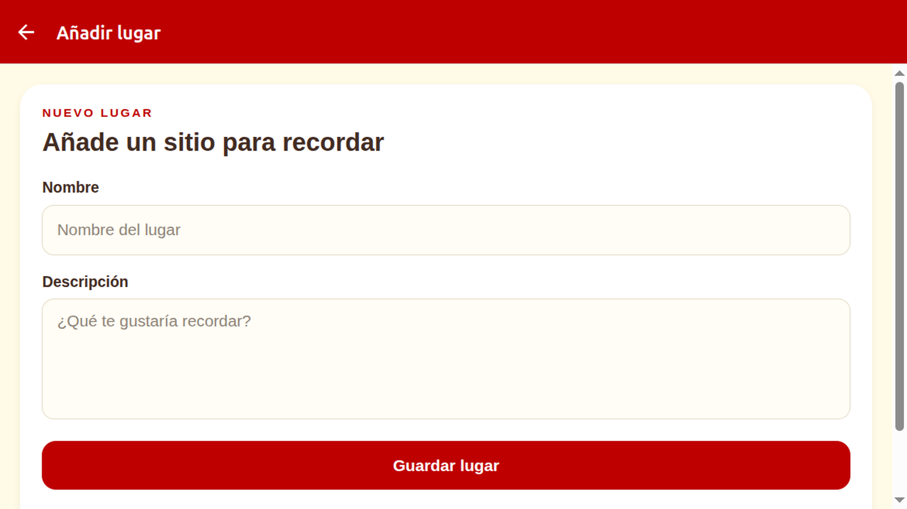
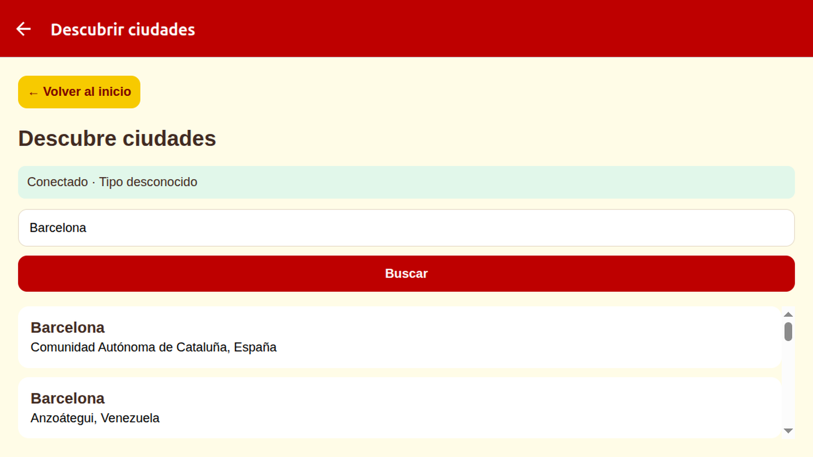

# MyPlaces

Aplicación móvil hecha con React Native, Expo y JavaScript para guardar y
consultar lugares de interés.

## Estructura

```text
src/
├── app/
│   ├── _layout.jsx
│   ├── index.jsx
│   ├── afegir.jsx
│   ├── descobreix.jsx
│   ├── accelerometre.jsx
│   ├── data/
│   │   └── id.js
│   └── detall/
│       └── location-detail.jsx
├── components/
│   ├── location-cards.jsx
│   └── location-storage.jsx
├── constants/
│   └── theme.ts
├── hooks/
│   ├── use-color-scheme.ts
│   ├── use-color-scheme.web.ts
│   └── use-theme.ts
└── global.css
```

Las pantallas y la lógica funcional de los apartados de esta entrega están en
JavaScript (`.js`/`.jsx`). El template de Expo conserva utilidades auxiliares
de tema en TypeScript (`.ts`); `src/hooks/use-color-scheme.web.ts` forma parte
de ese template y no se ha modificado.

## Apartado A: navegación y componentes

La pantalla principal muestra los lugares guardados. Al tocar una tarjeta, se
abre el detalle correspondiente. Cada lugar tiene un identificador propio y
las tarjetas se dibujan con un componente reutilizable:

- **Lista principal:** `src/app/index.jsx` carga los lugares guardados con
  `getLocationList()` y los muestra con `FlatList`. Cada elemento usa su `id`
  como clave.
- **Identificador:** cada lugar guardado tiene un `id` único. Ese mismo
  identificador se envía al abrir el detalle.
- **Componente reutilizable:** `src/components/location-cards.jsx` recibe un
  lugar y dibuja su tarjeta como `LocationCard`. La pantalla principal
  reutiliza el componente para cada elemento de la lista.
- **Navegación:** al pulsar una tarjeta, Expo Router abre
  `/detall/location-detail?id=<id>`. La configuración de pantallas está en
  `src/app/_layout.jsx`.
- **Detalle:** `src/app/detall/location-detail.jsx` lee el parámetro `id`,
  busca el lugar en la lista guardada y muestra su nombre, categoría y
  descripción. La carga usa `async`/`await` y gestiona los errores. Si el
  identificador no existe, informa del problema y permite volver a la lista.

### Recorrido de los datos

almacenamiento local → `index.jsx` → tarjeta reutilizable → ruta de detalle con
el `id` → consulta del lugar guardado → pantalla de detalle.

#### Capturas: lista y detalle

<details>
<summary>Pantalla principal — lista con PruebaG (Android, G2: persistencia)</summary>

</details>

<details>
<summary>Detalle de PruebaG (Android, G1)</summary>

</details>

## Apartado B: formulario y validación

El formulario permite añadir un lugar con nombre y descripción. El nombre es
obligatorio: si se deja vacío, aparece un mensaje de error y no se guarda el
lugar.

- **Acceso al formulario:** el botón «Añadir un lugar» de
  `src/app/index.jsx` abre la ruta interna `/afegir`.
- **Campos del formulario:** `src/app/afegir.jsx` tiene un `TextInput` para el
  nombre y otro para la descripción. Sus valores se controlan con los estados
  `locationName` y `locationDescription`, y se actualizan con `onChangeText`.
- **Validación:** antes de guardar se aplica `trim()` al nombre. Si queda
  vacío, se muestra un mensaje de error. Al escribir de nuevo, el mensaje
  desaparece.
- **Visualización del error:** en `afegir.jsx`, la expresión condicional
  `{errorMessage ? (...) : null}` muestra el componente de texto solo cuando
  `errorMessage` contiene un mensaje; si está vacío, no se renderiza nada. El
  atributo `accessibilityLiveRegion="polite"` hace que los lectores de pantalla
  anuncien el mensaje cuando aparece, sin interrumpir lo que estaban leyendo.
- **Guardar:** si el nombre es válido, se guardan el nombre y la descripción
  recortados mediante `addLocation()` en `src/components/location-storage.jsx`.
  La categoría de los lugares añadidos es «Personalizado». Una vez guardado,
  se vuelve a la lista.
- **Volver a la lista:** el enlace «Volver a la lista» permite salir del
  formulario sin guardar.

### Recorrido de los datos

`index.jsx` → formulario `/afegir` → validación del nombre con `trim()` →
`addLocation()` → almacenamiento local → lista y detalle actualizados.

#### Captura: formulario

<details>
<summary>Formulario «Añadir lugar» (Expo Web)</summary>

</details>

## Apartado C: persistencia local

Los lugares se guardan en el dispositivo con AsyncStorage. Al volver a abrir la
app, se recupera la lista guardada; también se pueden eliminar lugares. Si aún
no se ha añadido ninguno, la lista aparece vacía.

- **Almacenamiento:** `src/components/location-storage.jsx` centraliza las
  operaciones de lectura, alta y eliminación. La lista se guarda como JSON en
  AsyncStorage con la clave `location_list`.
- **Lista inicialmente vacía:** `getLocationList()` devuelve una lista vacía
  (`[]`) cuando todavía no existe ningún dato guardado. No se cargan lugares
  de ejemplo desde `src/app/data/id.js`.
- **Recuperación:** al abrir la pantalla principal,
  `src/app/index.jsx` llama a `getLocationList()` y muestra el resultado. La
  pantalla de detalle también lee la lista persistida para encontrar el lugar
  seleccionado. Así, los lugares siguen disponibles tras cerrar y volver a
  abrir la aplicación.
- **Alta persistente:** `addLocation()` agrega el lugar a la lista y guarda de
  nuevo la lista completa en AsyncStorage. Asigna un identificador que no esté
  ya en uso.
- **Eliminación:** cada tarjeta de `src/components/location-cards.jsx` tiene
  un botón «Eliminar». La pantalla principal llama a `removeLocation()` para
  quitar el lugar y guardar la lista actualizada. Si no quedan lugares, se
  muestra un mensaje indicando que la lista está vacía.
- **Errores:** si no se puede cargar, guardar o eliminar un lugar, se informa
  del error en la interfaz y no se presenta la operación como completada.

### Recorrido de la persistencia

`afegir.jsx` → `addLocation()` → AsyncStorage (`location_list`) →
`getLocationList()` → `index.jsx` y detalle.

Para eliminar: botón de la tarjeta → `removeLocation()` → AsyncStorage →
lista actualizada.

#### Captura: lista vacía

<details>
<summary>Lista sin lugares y contador a cero (Android, G3)</summary>

</details>

La captura de la lista con el lugar conservado tras reiniciar Expo Go (G2)
está en el apartado A, junto a la pantalla principal.

## Apartado D: consulta HTTP/HTTPS

En «Descubre ciudades» se buscan lugares con la API pública de Open-Meteo. Se
accede desde el inicio y se puede volver a la lista principal con «Volver al
inicio».

### API y petición

Se utiliza [Open-Meteo Geocoding API](https://open-meteo.com/en/docs/geocoding-api),
que no requiere clave. La petición se hace con `fetch()` a
`https://geocoding-api.open-meteo.com/v1/search` y estos parámetros:

- `name`: texto de búsqueda. La pantalla empieza con «Barcelona» y permite
  cambiarlo en el campo «Nombre de la ciudad».
- `count=10`: solicita como máximo diez coincidencias.
- `language=es`: solicita los nombres en español cuando están disponibles.
- `format=json`: solicita la respuesta en formato JSON.

El botón «Buscar» y la tecla de búsqueda del teclado envían la consulta. Antes
de construir la URL se eliminan espacios al principio y al final del texto, y
`encodeURIComponent()` codifica el término para que pueda viajar correctamente
como parámetro de la URL. Cada nuevo término inicia otra petición.

### Resultados y estados de pantalla

La respuesta JSON contiene `results`. Si es una lista, sus elementos se
muestran en un `FlatList`, que representa cada ciudad con su nombre, región y
país. El identificador de Open-Meteo se usa como clave de cada fila.

La pantalla informa del estado de la búsqueda. El contenido de cada estado se
asigna a `searchContent` mediante condiciones explícitas:

- **Carga:** mientras espera la respuesta, muestra un indicador animado y el
  texto «Cargando...».
- **Error:** si la petición falla, devuelve un estado HTTP no satisfactorio o
  la respuesta no tiene el formato esperado, muestra un mensaje de error. El
  detalle técnico también se escribe en la consola mediante `console.error`.
  El botón «Reintentar» vuelve a enviar la petición.
- **Lista vacía:** si la API responde correctamente pero no encuentra
  coincidencias (la lista `results` está vacía o no viene en la respuesta),
  muestra «No se han encontrado ciudades».
- **Resultados:** si hay coincidencias, presenta la lista desplazable de
  ciudades.

Al salir de la pantalla se invalida la petición pendiente para evitar que una
respuesta tardía intente actualizar el estado de una pantalla que ya no está
montada.

### Recorrido de la consulta

`index.jsx` → `/descobreix` → escribir una ciudad → `fetch()` a Open-Meteo →
carga, error, lista vacía o resultados.

#### Captura: resultados de la API

<details>
<summary>Pantalla «Descubre ciudades» — resultados de Barcelona (Expo Web)</summary>

</details>

## Apartado E: ubicación y permisos

### Permisos: pedir solo lo necesario

La app solo solicita la ubicación cuando se pulsa «Utiliza mi ubicación». No
pide permiso al abrirse ni accede a la ubicación en segundo plano:

- Al pulsar «Utiliza mi ubicación», `src/app/index.jsx` solicita el
  permiso de primer plano con `requestForegroundPermissionsAsync()` de
  `expo-location`.
- La app comprueba que `status` sea `"granted"` antes de acceder a la posición.
- Si el permiso se deniega, muestra un mensaje y el resto de la app sigue
  disponible.
- La solicitud explica que la ubicación se usa para mostrar las coordenadas.
  El texto del permiso en iOS está configurado en el plugin `expo-location` de
  `app.json`.

### GPS con Expo Location

Con el permiso concedido, la app obtiene la ubicación actual y muestra la
latitud y la longitud con seis decimales:

```js
const { status } = await Location.requestForegroundPermissionsAsync();

if (status !== "granted") {
  setLocationError(
    "Debes conceder permiso de ubicación para mostrar las coordenadas.",
  );
  return;
}

const position = await Location.getCurrentPositionAsync({});

setCoordinates({
  latitude: position.coords.latitude,
  longitude: position.coords.longitude,
});
```

La dependencia `expo-location` se instala con `npx expo install expo-location`.
La ubicación se debe probar en un dispositivo o entorno que proporcione GPS;
los resultados dependen de las capacidades del dispositivo y de que los
servicios de ubicación estén disponibles.

#### Captura: permiso denegado

<details>
<summary>Aviso al denegar el permiso de ubicación (Android, G5)</summary>

</details>

### Si no aparece el cuadro de permiso en el navegador

Cuando la app se ejecuta en Expo Web, el permiso lo controla el navegador.
Si se denegó anteriormente, el navegador puede no volver a mostrar el cuadro
automáticamente. Para habilitarlo:

1. Pulsa el icono que aparece a la izquierda de la dirección `localhost:8081`.
2. En el panel del sitio, activa **Ubicación**.
3. Si el permiso sigue bloqueado, pulsa **Restablecer permiso** en ese panel.
4. Vuelve a la app y pulsa **Utiliza mi ubicación**. Cuando el navegador lo
   solicite, permite el acceso.

<details>
<summary>Activar o restablecer el permiso de ubicación para localhost</summary>

</details>

## Apartado F: conectividad

### Estado de conexión con NetInfo

En «Descubre ciudades» se muestra el estado de conexión y, cuando está
disponible, el tipo de red. Para obtenerlo se usa `useNetInfo()` de
`@react-native-community/netinfo`:

```js
const { type, isConnected, isInternetReachable } = useNetInfo();

const isOffline = isConnected === false || isInternetReachable === false;
```

`isConnected` indica si hay una conexión de red y `isInternetReachable` si se
puede acceder a Internet. El valor `type` se convierte en un texto legible con
el objeto `NETWORK_TYPES` (por ejemplo, `wifi` se muestra como «Wi-Fi»).

### Evitar consultas cuando no hay Internet

La búsqueda de ciudades necesita Internet; la lista guardada y la función de
ubicación no dependen de esa consulta. Por eso el estado de red aparece en
«Descubre», junto a la búsqueda.

- Si NetInfo todavía está comprobando la conexión, la pantalla espera antes de
  iniciar la búsqueda.
- Si no hay conexión o Internet no es accesible, muestra un aviso y no envía la
  consulta.
- Si se pierde la conexión mientras se carga una búsqueda, se cancela esa
  petición. Cuando vuelve, la búsqueda se inicia de nuevo.

La dependencia se instala con `npx expo install
@react-native-community/netinfo`, que selecciona una versión compatible con el
SDK de Expo del proyecto.

#### Captura: error de red

<details>
<summary>Aviso de desconexión en «Descubre ciudades» (Android, G4)</summary>

</details>

## Ejecutar la aplicación

Instala las dependencias e inicia Expo:

```bash
npx expo start
```

## Apartado G: pruebas y documentación reproducibles

### Preparar el entorno

Hace falta Node.js, npm y un dispositivo o emulador con Expo Go. Para probar
la ubicación, activa los servicios de ubicación del dispositivo.

```bash
npm install
npx expo start
```

En Android, inicia un AVD desde Android Studio antes de ejecutar
`npx expo start --android`. Comprueba que aparece en `adb devices -l`. Si usas
un dispositivo físico, conéctalo a la misma red Wi-Fi que el ordenador, abre
Expo Go y escanea el código QR que muestra Expo. En iOS, abre el proyecto con
Expo Go desde el código QR; se necesita un iPhone con Expo Go para comprobar
los permisos nativos de iOS. Mantén el servidor de Expo en ejecución durante
la prueba.

Antes de empezar, elimina los lugares guardados desde la propia aplicación
(botón «Eliminar» de cada tarjeta) hasta que aparezca «No tienes lugares
guardados todavía». Así se prepara un estado inicial vacío sin borrar datos
de otros proyectos de Expo Go.

### Pruebas en Android

Las pruebas se realizaron el 6 de noviembre de 2026 con Expo Go en un emulador
Android `sdk_gphone16_x86_64` (Android 17, API 37). La tabla reúne los pasos
para repetir cada caso, el resultado esperado y el resultado observado. Para
G2 se cerró Expo Go con `adb shell am force-stop host.exp.exponent`; para G4 se
desactivaron y reactivaron Wi-Fi y los datos móviles mediante ADB.

| ID  | Caso                          | Pasos reproducibles                                                                                                                                                                | Resultado esperado                                                                                                                                    | Resultado obtenido                                                                                                                    | Observaciones                                                                 |
| --- | ----------------------------- | ---------------------------------------------------------------------------------------------------------------------------------------------------------------------------------- | ----------------------------------------------------------------------------------------------------------------------------------------------------- | ------------------------------------------------------------------------------------------------------------------------------------- | ----------------------------------------------------------------------------- |
| G1  | Creación                      | Desde la lista vacía, pulsa «Añadir un lugar», introduce `PruebaG` y `Lugar de Android`, pulsa «Guardar lugar» y abre la tarjeta creada.                                           | La lista muestra el lugar; el detalle conserva el nombre, la categoría «Personalizado» y la descripción.                                              | Aprobado: se creó `PruebaG` con `Lugar de Android`; la lista y el detalle muestran los datos esperados.                               | Ejecutado en emulador Android.                                                |
| G2  | Reinicio y persistencia       | Después de G1, cierra completamente Expo Go desde el selector de aplicaciones y vuelve a abrir el mismo proyecto.                                                                  | `PruebaG` sigue en la lista y se puede volver a abrir su detalle.                                                                                     | Aprobado: el lugar siguió en la lista después de reiniciar Expo Go.                                                                   | Se usó `adb shell am force-stop host.exp.exponent`; no se borraron los datos. |
| G3  | Ausencia de datos             | En la lista, elimina todos los lugares guardados. Vuelve a la pantalla principal si es necesario.                                                                                  | Aparecen «No tienes lugares guardados todavía» y el contador `0 lugares`; no se muestran datos de ejemplo.                                            | Aprobado: al eliminar `PruebaG` apareció el mensaje de lista vacía y el contador `0 lugares`.                                         | Ejecutado en emulador Android.                                                |
| G4  | Error de red                  | Abre «Descubre ciudades» y desactiva Wi-Fi y los datos móviles desde los ajustes del dispositivo.                                                                                  | El estado de red indica que no hay Internet y la pantalla muestra el aviso de desconexión. Al recuperar la conexión, se reanuda la búsqueda.          | Aprobado: sin red se mostró `Sin conexión a Internet`; al reactivarla, volvió `Conectado · Wi-Fi` y cargaron resultados de Barcelona. | Se usaron `adb shell svc wifi disable` y `adb shell svc data disable`.        |
| G5  | Permiso de ubicación denegado | Deniega el permiso cuando el sistema lo solicite al pulsar «Utiliza mi ubicación». Si ya lo habías concedido, revócalo en los ajustes del sistema para Expo Go y repite la acción. | Aparece «Debes conceder permiso de ubicación para mostrar las coordenadas.»; no se muestran coordenadas y el resto de la aplicación sigue disponible. | Aprobado: apareció el aviso de permiso denegado y no se mostraron coordenadas.                                                        | Permisos de Expo Go revocados; se eligió «No permitir» en Android.            |

#### Evidencias de las cinco pruebas

Guardé una captura de cada caso durante las pruebas en Android.

<details>
<summary>G1 — Creación y detalle del lugar</summary>

</details>

<details>
<summary>G2 — Persistencia después de reiniciar Expo Go</summary>

</details>

<details>
<summary>G3 — Lista vacía</summary>

</details>

<details>
<summary>G4 — Error de red</summary>

</details>

<details>
<summary>G5 — Permiso de ubicación denegado</summary>

</details>

Para repetir las pruebas, sigue el orden G1 → G2 → G3 → G4 → G5 en un único
dispositivo. G3 deja la lista vacía para iniciar una nueva ronda. En esta
ejecución, los permisos de ubicación se restauraron a su estado inicial
después de probar la denegación.

### Limitaciones del entorno de prueba

- Las pruebas nativas se realizaron en el emulador Android
  `sdk_gphone16_x86_64`, Android 17 (API 37); la ubicación depende del GPS
  simulado del emulador.
- La comprobación web es complementaria y no sustituye la prueba nativa. En
  web, G2 y G4 solo se comprobaron parcialmente y G5 no se pudo ejecutar.
- En esta ejecución no se generó un APK ni se probó con un sensor físico.

## Ampliación voluntaria: lecturas del acelerómetro

La pantalla `src/app/accelerometre.jsx`, accesible desde «Probar acelerómetro»
en el inicio, muestra las lecturas de los ejes X, Y y Z del dispositivo:

- En Android e iOS, la pantalla comprueba la disponibilidad al abrirse, fija el
  intervalo de actualización a 250 ms y empieza a escuchar automáticamente.
  `Accelerometer.addListener()` recibe las lecturas X, Y y Z, expresadas en `g`
  (1 g equivale aproximadamente a 9,81 m/s²).
- En web, el botón «Permitir movimiento e iniciar» solicita el permiso dentro
  de una acción del usuario, como requieren algunos navegadores, y después
  comprueba la disponibilidad del sensor.
- Al salir de la pantalla se llama a `subscription.remove()` para dejar de
  escuchar el sensor. No se mantiene una suscripción activa en segundo plano.
- Si el navegador deniega el permiso o el dispositivo no tiene un acelerómetro
  disponible, la pantalla muestra un mensaje en vez de iniciar las lecturas.

`expo-sensors` ya forma parte de las dependencias del proyecto. El plugin
configurado en `app.json` proporciona el texto de permiso de movimiento
necesario para iOS. Tras cambiar esta configuración nativa, hay que reconstruir
la aplicación; en Expo Go, la disponibilidad y los permisos dependen del
dispositivo.

Para probar la función, abre «Probar acelerómetro» y mueve un dispositivo con
sensor. En web, pulsa «Permitir movimiento e iniciar» para pedir el permiso
dentro de una acción del usuario. En navegador de escritorio el sensor puede
no estar disponible; en web móvil puede requerirse un contexto seguro (HTTPS).

Si el navegador no muestra una solicitud o indica que el acceso está bloqueado,
permite el movimiento/orientación en los ajustes de permisos del sitio y
recarga la página. Los navegadores no siempre vuelven a mostrar el diálogo
después de haber denegado el permiso. En iPhone, la API web de movimiento suele
requerir Safari; el acelerómetro nativo se debe probar con la app en un
dispositivo físico.
