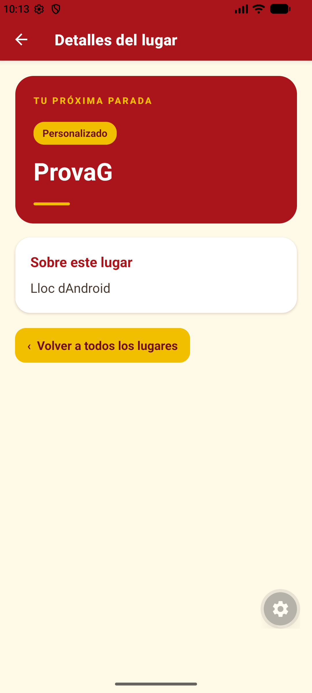
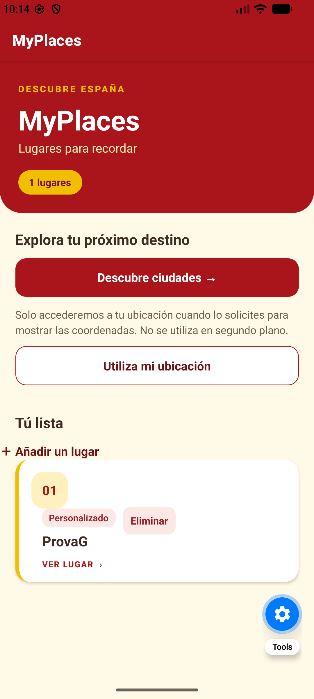
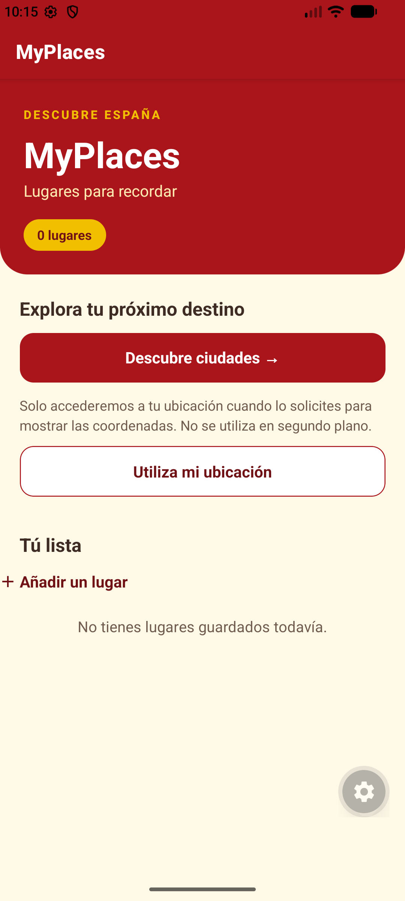
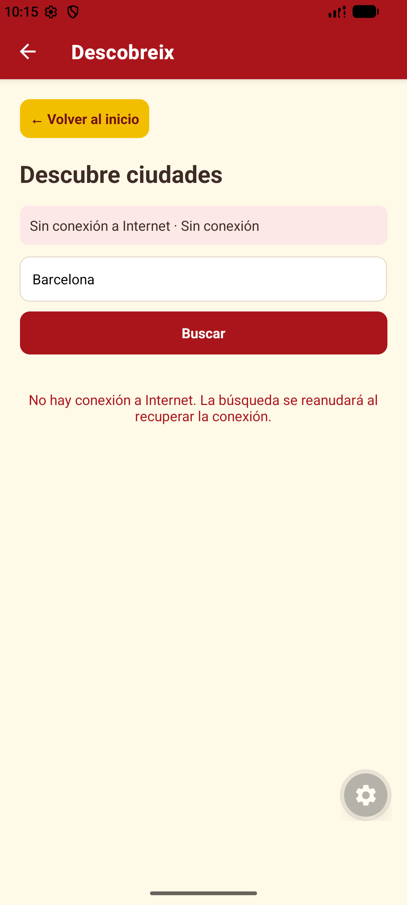
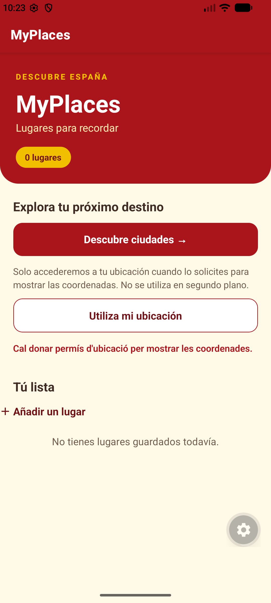

# MyPlaces

Aplicación móvil hecha con React Native, Expo y JavaScript para guardar y
consultar lugares de interés.

## Apartado A: navegación y componentes

El apartado A pide una pantalla principal con una lista de lugares, una pantalla
de detalle, navegación entre ambas, un identificador para cada lugar y al menos
un componente reutilizable. MyPlaces lo resuelve así:

- **Lista principal:** `src/app/index.jsx` carga los lugares guardados con
  `getLocationList()` y los muestra con `FlatList`. Cada elemento usa su `id`
  como clave.
- **Identificador:** cada lugar guardado tiene un `id` único. Ese mismo
  identificador se envía al abrir el detalle.
- **Componente reutilizable:** `src/components/location-cards.jsx` recibe un
  lugar y dibuja su tarjeta. La pantalla principal reutiliza el componente para
  cada elemento de la lista.
- **Navegación:** al pulsar una tarjeta, Expo Router abre
  `/detall/location?id=<id>`. La configuración de pantallas está en
  `src/app/_layout.jsx`.
- **Detalle:** `src/app/detall/location-detail.jsx` lee el parámetro `id`,
  busca el lugar en la lista guardada y muestra su nombre, categoría y
  descripción. Si el identificador no existe, informa del problema y permite
  volver a la lista.

### Recorrido de los datos

almacenamiento local → `index.jsx` → tarjeta reutilizable → ruta de detalle con
el `id` → consulta del lugar guardado → pantalla de detalle.

## Apartado B: formulario y validación

El apartado B pide una pantalla para añadir un lugar con nombre y descripción,
impedir que se guarde con el nombre vacío, informar del error y permitir volver
a la lista. MyPlaces lo resuelve así:

- **Acceso al formulario:** el botón «Añadir un lugar» de
  `src/app/index.jsx` abre la ruta `/afegir`.
- **Campos del formulario:** `src/app/afegir.jsx` tiene un `TextInput` para el
  nombre y otro para la descripción. Sus valores se controlan con estado de
  React y `onChangeText`.
- **Validación:** antes de guardar se aplica `trim()` al nombre. Si queda
  vacío, se muestra un mensaje de error. Al escribir de nuevo, el mensaje
  desaparece.
- **Visualización del error:** en `afegir.jsx`, la expresión condicional
  `{error ? (...) : null}` muestra el componente de texto solo cuando `error`
  contiene un mensaje; si está vacío, no se renderiza nada. El atributo
  `accessibilityLiveRegion="polite"` hace que los lectores de pantalla anuncien
  el mensaje cuando aparece, sin interrumpir lo que estaban leyendo.
- **Guardar:** si el nombre es válido, se guardan el nombre y la descripción
  recortados mediante `addLocation()` en `src/components/location-storage.jsx`.
  La categoría de los lugares añadidos es «Personalizado». Una vez guardado,
  se vuelve a la lista.
- **Volver a la lista:** el enlace «Volver a la lista» permite salir del
  formulario sin guardar.

### Recorrido de los datos

`index.jsx` → formulario `/afegir` → validación del nombre con `trim()` →
`addLocation()` → almacenamiento local → lista y detalle actualizados.

## Apartado C: persistencia local

El apartado C pide guardar los lugares en el dispositivo, recuperarlos al
reiniciar la aplicación, permitir eliminarlos y contemplar que la lista
inicialmente esté vacía. MyPlaces lo resuelve con AsyncStorage:

- **Almacenamiento:** `src/components/location-storage.jsx` centraliza las
  operaciones de lectura, alta y eliminación. La lista se guarda como JSON en
  AsyncStorage con la clave `location_list`.
- **Lista inicialmente vacía:** `getLocationList()` devuelve una lista vacía
  (`[]`) cuando todavía no existe ningún dato guardado. No se cargan lugares
  de ejemplo desde `src/app/data/id.js`.
- **Recuperación:** al abrir la pantalla principal,
  `src/app/index.jsx` llama a `getLocationList()` y muestra el resultado. La
  pantalla de detalle también lee la lista persistida para encontrar el lugar
  seleccionado. Así, los lugares siguen disponibles tras cerrar y volver a
  abrir la aplicación.
- **Alta persistente:** `addLocation()` agrega el lugar a la lista y guarda de
  nuevo la lista completa en AsyncStorage. Asigna un identificador que no esté
  ya en uso.
- **Eliminación:** cada tarjeta de `src/components/location-cards.jsx` tiene
  un botón «Eliminar». La pantalla principal llama a `removeLocation()` para
  quitar el lugar y guardar la lista actualizada. Si no quedan lugares, se
  muestra un mensaje indicando que la lista está vacía.
- **Errores:** si no se puede cargar, guardar o eliminar un lugar, se informa
  del error en la interfaz y no se presenta la operación como completada.

### Recorrido de la persistencia

`afegir.jsx` → `addLocation()` → AsyncStorage (`location_list`) →
`getLocationList()` → `index.jsx` y detalle.

Para eliminar: botón de la tarjeta → `removeLocation()` → AsyncStorage →
lista actualizada.

## Apartado D: consulta HTTP/HTTPS

La pantalla `src/app/descobreix.jsx` consulta una API pública por HTTPS y
muestra ciudades según el texto introducido. Se abre desde el botón
«Descobreix ciutats» de `src/app/index.jsx`; la ruta está configurada en
`src/app/_layout.jsx`. El botón «Volver al inicio» permite regresar a la lista
principal.

### API y petición

Se utiliza [Open-Meteo Geocoding API](https://open-meteo.com/en/docs/geocoding-api),
que no requiere clave. La petición se hace con `fetch()` a
`https://geocoding-api.open-meteo.com/v1/search` y estos parámetros:

- `name`: texto de búsqueda. La pantalla empieza con «Barcelona» y permite
  cambiarlo en el campo «Nombre de la ciudad».
- `count=10`: solicita como máximo diez coincidencias.
- `language=ca`: pide los nombres en catalán cuando están disponibles.
- `format=json`: solicita la respuesta en formato JSON.

El botón «Buscar» y la tecla de búsqueda del teclado envían la consulta. Antes
de construir la URL se eliminan espacios al principio y al final del texto, y
`encodeURIComponent()` codifica el término para que pueda viajar correctamente
como parámetro de la URL. Cada nuevo término inicia otra petición.

### Resultados y estados de pantalla

La respuesta JSON contiene `results`. Si es una lista, sus elementos se
muestran en un `FlatList`, que representa cada ciudad con su nombre, región y
país. El identificador de Open-Meteo se usa como clave de cada fila.

La pantalla presenta estados alternativos para que la persona sepa qué ocurre:

- **Carga:** mientras espera la respuesta, muestra un indicador animado y el
  texto «Cargando...».
- **Error:** si la petición falla, devuelve un estado HTTP no satisfactorio o
  la respuesta no tiene el formato esperado, muestra un mensaje de error. El
  detalle técnico también se escribe en la consola mediante `console.error`.
  El botón «Reintentar» vuelve a enviar la petición.
- **Lista vacía:** si la API responde correctamente pero no encuentra
  coincidencias (la lista `results` está vacía o no viene en la respuesta),
  muestra «No se han encontrado ciudades».
- **Resultados:** si hay coincidencias, presenta la lista desplazable de
  ciudades.

Al salir de la pantalla se invalida la petición pendiente para evitar que una
respuesta tardía intente actualizar el estado de una pantalla que ya no está
montada.

### Recorrido de la consulta

`index.jsx` → `/descobreix` → escribir una ciudad → `fetch()` a Open-Meteo →
carga, error, lista vacía o resultados.

## Apartado E: ubicación y permisos

### Permisos: pedir solo lo necesario

El usuario controla los permisos de su dispositivo. MyPlaces solo necesita
acceder a la ubicación cuando la persona lo solicita, así que no la pide al
abrir la app ni solicita acceso en segundo plano:

- Al pulsar «Utilitza la meva ubicació», `src/app/index.jsx` solicita el
  permiso de primer plano con `requestForegroundPermissionsAsync()` de
  `expo-location`.
- La app comprueba que `status` sea `"granted"` antes de acceder a la posición.
- Si el permiso se deniega, muestra un mensaje y el resto de la app sigue
  disponible.
- La solicitud explica que la ubicación se usa para mostrar las coordenadas.
  El texto del permiso en iOS está configurado en el plugin `expo-location` de
  `app.json`.

### GPS con Expo Location

Con el permiso concedido, la app obtiene la ubicación actual y muestra la
latitud y la longitud con seis decimales:

```js
const { status } = await Location.requestForegroundPermissionsAsync();

if (status !== "granted") {
  setLocationError("Cal donar permís d'ubicació per mostrar les coordenades.");
  return;
}

const pos = await Location.getCurrentPositionAsync({
  accuracy: Location.Accuracy.Balanced,
});

setCoordinates({
  latitude: pos.coords.latitude,
  longitude: pos.coords.longitude,
});
```

La dependencia `expo-location` se instala con `npx expo install expo-location`.
La ubicación se debe probar en un dispositivo o entorno que proporcione GPS;
los resultados dependen de las capacidades del dispositivo y de que los
servicios de ubicación estén disponibles.

## Apartado F: conectividad

### Estado de conexión con NetInfo

La pantalla `src/app/descobreix.jsx` muestra si el dispositivo está conectado
y el tipo de red disponible, como Wi-Fi o datos móviles. El estado se obtiene
con `useNetInfo()` de `@react-native-community/netinfo`:

```js
const { type, isConnected, isInternetReachable } = useNetInfo();

const isOffline =
  isConnected === false || isInternetReachable === false;
```

`isConnected` indica si hay una conexión de red y `isInternetReachable` si se
puede acceder a Internet. El valor `type` se convierte en un texto legible con
el objeto `NETWORK_TYPES` (por ejemplo, `wifi` se muestra como «Wi-Fi»).

### Evitar consultas cuando no hay Internet

La comprobación se hace en «Descubre» porque esa pantalla busca ciudades en la
API de Open-Meteo. La pantalla principal (`src/app/index.jsx`) trabaja con
lugares guardados localmente y la ubicación del dispositivo, así que no
necesita Internet para esas funciones. Por tanto, el indicador se muestra
junto a la búsqueda que depende de la conexión, no en el inicio.

- Si NetInfo todavía está comprobando la conexión, la pantalla espera antes de
  iniciar la búsqueda.
- Si no hay conexión o Internet no es accesible, muestra un aviso y no envía la
  consulta.
- Si se pierde la conexión mientras se carga una búsqueda, se cancela esa
  petición. Cuando vuelve, la búsqueda se inicia de nuevo.

La dependencia se instala con `npx expo install
@react-native-community/netinfo`, que selecciona una versión compatible con el
SDK de Expo del proyecto.

## Ejecutar la aplicación

Instala las dependencias con `npm install` y luego inicia Expo:

```bash
npx expo start
```

## Apartat G: proves i documentació reproduïbles

### Preparar l'entorn

Requisits: Node.js, npm i les dependències del projecte. Per provar la ubicació
cal un dispositiu o emulador Android/iOS amb Expo Go i els serveis d'ubicació
activats.

```bash
npm install
npx expo start
```

Per a Android, inicia un AVD des d'Android Studio abans d'executar
`npx expo start --android`. Comprova que apareix a `adb devices -l`. En un
dispositiu físic, connecta'l a la mateixa xarxa Wi-Fi que l'ordinador, obre
Expo Go i escaneja el codi QR que mostra Expo. Per a iOS, obre el projecte amb
Expo Go des del codi QR; cal un iPhone amb Expo Go per comprovar els permisos
natius d'iOS. Mantén el servidor d'Expo en execució durant la prova.

Abans de començar, elimina els llocs guardats des de la mateixa app (botó
«Eliminar» de cada targeta) fins que aparegui «No tienes lugares guardados
todavía». Això prepara un estat inicial buit sense esborrar dades d'altres
projectes d'Expo Go.

### Casos de prova manuals

| ID | Cas | Passos reproduïbles | Resultat esperat |
|---|---|---|---|
| G1 | Creació | Des de la llista buida, prem «Añadir un lugar», introdueix `ProvaG` i `Lloc dAndroid`, prem «Guardar lugar» i obre la targeta creada. | La llista mostra el lloc; el detall conserva el nom, la categoria «Personalizado» i la descripció. |
| G2 | Reinici i persistència | Després de G1, tanca completament Expo Go des del selector d'aplicacions i torna a obrir el mateix projecte. | `Prova G` continua a la llista i el seu detall es pot tornar a obrir. No esborris les dades entre els dos passos. |
| G3 | Absència de dades | A la llista, elimina tots els llocs desats. Torna a la pantalla principal si cal. | Es mostra «No tienes lugares guardados todavía» i el comptador indica `0 lugares`; no apareixen dades d'exemple. |
| G4 | Error de xarxa | Obre «Descubre ciudades» i activa el mode avió o desactiva Wi-Fi i dades mòbils des dels ajustos del dispositiu. | L'estat de xarxa indica que no hi ha Internet i la pantalla mostra l'avís de manca de connexió en lloc dels resultats. En recuperar la connexió, la cerca es reprèn. |
| G5 | Permís d'ubicació denegat | Denega el permís quan el sistema el demani en prémer «Utiliza mi ubicación». Si ja s'havia concedit, revoca'l als ajustos del sistema per a Expo Go i repeteix l'acció. | Es mostra «Cal donar permís d'ubicació per mostrar les coordenades.»; no apareixen coordenades i la resta de la app continua disponible. |

### Registre d'execució

Data de registre: 2026-11-06. Projecte: Expo SDK 58.0.19, provat amb Expo Go
en un emulador Android `sdk_gphone16_x86_64` (Android 17, API 37). Servidor
local iniciat amb `npx expo start --android --host localhost --port 8082` i
connexió ADB per al port 8082. Resultats observats:

| ID | Resultat en emulador/dispositiu | Evidència |
|---|---|---|
| G1 | Passa | Creat `ProvaG` amb descripció `Lloc dAndroid`; la llista mostra una ubicació i el detall conserva nom, categoria i descripció. |
| G2 | Passa | Després de `adb shell am force-stop host.exp.exponent` i reobrir el projecte, `ProvaG` continua a la llista. |
| G3 | Passa | En eliminar `ProvaG`, el comptador mostra `0 lugares` i apareix el missatge de llista buida. |
| G4 | Passa | Desactivats Wi-Fi i dades amb `adb shell svc wifi disable` i `adb shell svc data disable`: l'app mostra `Sin conexión a Internet` i l'avís sense resultats. En reactivar-los, torna a `Conectado · Wi-Fi` i carrega resultats de Barcelona. |
| G5 | Passa | Revocats els permisos d'ubicació d'Expo Go i seleccionat «Don't allow» al diàleg Android: apareix l'avís de permís denegat i no es mostren coordenades. |

#### Captures de les proves

Les captures s'han pres a l'emulador Android durant l'execució descrita més
amunt. Obre cada apartat per veure'n la imatge.

<details>
<summary>G1 — Creació i detall del lloc</summary>

</details>

<details>
<summary>G2 — Lloc conservat després de reiniciar Expo Go</summary>

</details>

<details>
<summary>G3 — Absència de dades</summary>

</details>

<details>
<summary>G4 — Error de xarxa</summary>

</details>

<details>
<summary>G5 — Permís d'ubicació denegat</summary>

</details>

Per repetir-les, segueix l'ordre G1 → G2 → G3 → G4 → G5 en un únic
dispositiu. G3 deixa la llista buida per iniciar una nova ronda. En aquesta
execució, els permisos d'ubicació s'han restaurat al seu estat inicial després
de provar la denegació.

### Comprovació complementària al web

El 2026-11-06 s'ha iniciat Expo Web (`npx expo start --web --port 8081`) i
s'han comprovat aquests fluxos al navegador. No substitueixen una prova
nativa:

| Cas | Resultat web | Abast i límit |
|---|---|---|
| G1 | Passa | Alta de `Prova G`, targeta a la llista i detall amb descripció. |
| G2 | Passa parcialment | El lloc continua disponible després de recarregar la pàgina; no s'ha tancat/reobert Expo Go. |
| G3 | Passa | En eliminar el lloc, es mostra l'estat buit i el comptador `0 lugares`. |
| G4 | Passa parcialment | S'ha avortat la petició a Open-Meteo al navegador i s'han comprovat l'avís d'error i el botó «Reintentar»; no s'ha simulat el mode avió ni NetInfo natiu. |
| G5 | No executat | El navegador d'aquesta sessió no permet configurar el permís geogràfic (`Browser.grantPermissions` no està disponible); cal repetir-lo en Android/iOS. |

El typecheck (`npx tsc --noEmit`) acaba correctament. `npx expo lint` encara
falla per un diagnòstic existent a `src/hooks/use-color-scheme.web.ts:11`
(`react-hooks/set-state-in-effect`); no forma part d'aquest canvi.
